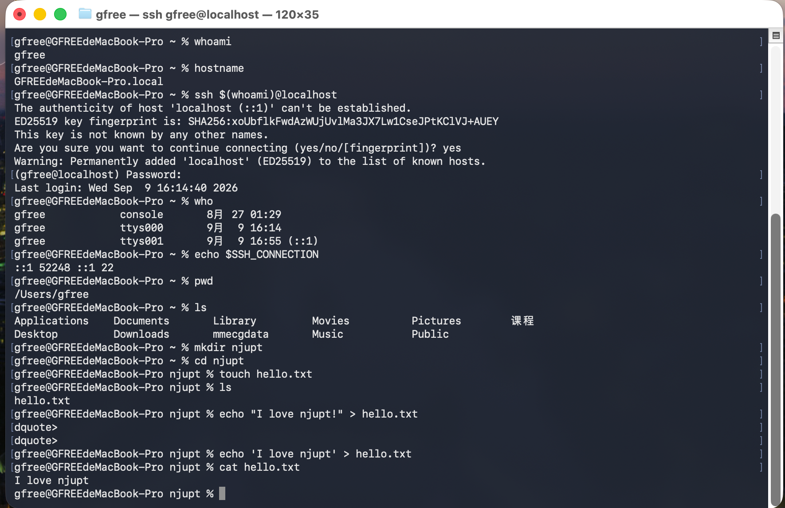

# 第二次 Linux 课程作业

姓名：郭雨杨  
学号：B24040003  

## 1. 查看本机主机名

使用 `hostname` 命令查看当前主机名：

```bash
hostname
```

运行结果：

```text
GFREEdeMacBook-Pro.local
```

## 2. 使用 SSH 登录本地主机

执行以下命令：

```bash
ssh $(whoami)@localhost
```

第一次连接时系统提示确认主机的 ED25519 指纹：

```text
The authenticity of host 'localhost (::1)' can't be established.
ED25519 key fingerprint is: SHA256:xoUbflkFwdAzWUjUvlMa3JX7Lw1CseJPtKClVJ+AUEY
Are you sure you want to continue connecting (yes/no/[fingerprint])?
```

输入：

```text
yes
```

然后输入当前用户密码，成功通过 SSH 登录本地主机。



## 3. 查看当前登录用户

使用：

```bash
who
```

运行结果：

```text
gfree    console    8月 27 01:29
gfree    ttys000    9月 9 16:14
gfree    ttys001    9月 9 16:55 (::1)
```

其中：

```text
gfree    ttys001    9月 9 16:55 (::1)
```

表示当前存在一个通过 IPv6 回环地址 `::1` 建立的 SSH 登录会话。

进一步执行：

```bash
echo $SSH_CONNECTION
```

得到：

```text
::1 52248 ::1 22
```

说明 SSH 客户端通过本机 IPv6 回环地址 `::1` 连接到 SSH 服务端的 22 端口。

![SSH 连接信息]

## 4. 查看当前工作目录

执行：

```bash
pwd
```

得到：

```text
/Users/gfree
```

说明当前工作目录为用户 `gfree` 的主目录。

## 5. 查看主目录内容

执行：

```bash
ls
```

得到：

```text
Applications    Documents    Library    Movies    Pictures    课程
Desktop         Downloads    mmecgdata  Music     Public
```

## 6. 创建目录和文件

首先创建一个名为 `njupt` 的目录：

```bash
mkdir njupt
```

进入该目录：

```bash
cd njupt
```

然后创建文件：

```bash
touch hello.txt
```

查看目录：

```bash
ls
```

得到：

```text
hello.txt
```

## 7. 向文件写入内容

使用重定向符号 `>` 将字符串写入 `hello.txt`：

```bash
echo 'I love njupt' > hello.txt
```

然后使用：

```bash
cat hello.txt
```

查看文件内容，得到：

```text
I love njupt
```

![目录及文件操作]

## 8. 实验总结

本次实验在 macOS 本机环境中完成。通过开启本机 SSH 服务并连接 `localhost`，完成了 SSH 登录实验，并使用 `who` 和 `SSH_CONNECTION` 验证了 SSH 会话。

同时练习了 Linux/Unix 系统中的基本文件操作命令，包括：

- `pwd`：查看当前工作目录
- `ls`：查看目录内容
- `mkdir`：创建目录
- `cd`：切换目录
- `touch`：创建文件
- `echo`：输出字符串
- `>`：将输出重定向到文件
- `cat`：查看文件内容