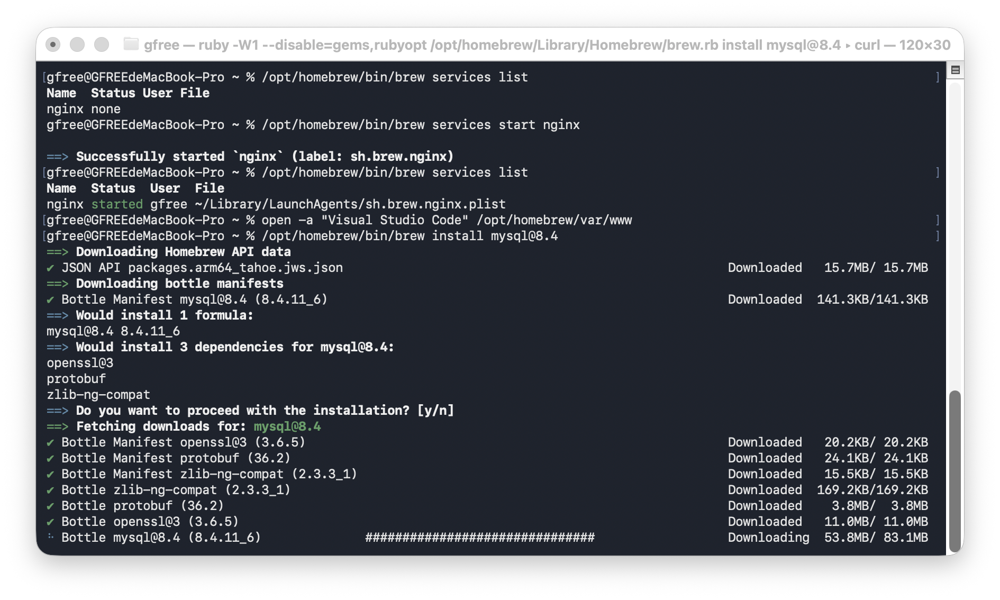
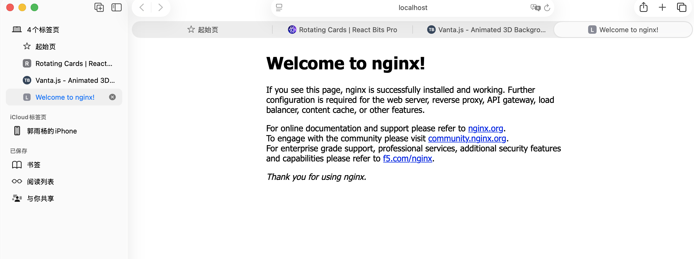
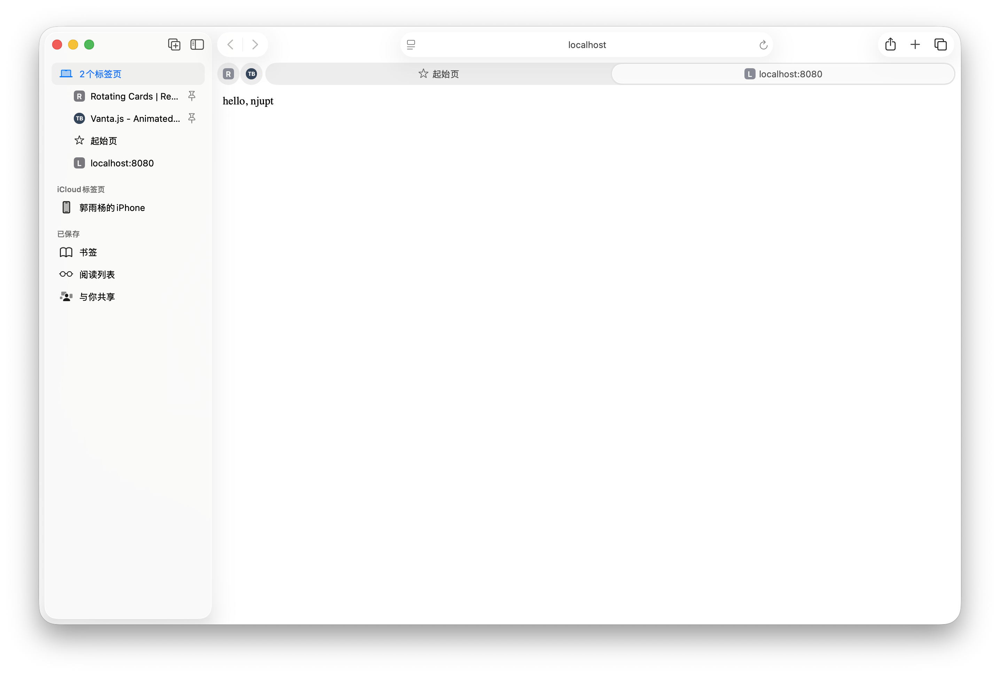

# 第三次 Linux 课程作业：搭建 Nginx Web 服务器

- 姓名：郭雨杨
- 学号：B24040003
- GitHub 用户名：jenmax-116
- 实验日期：2026 年 10 月 10 日
- 实验环境：macOS（Apple Silicon），Homebrew，Nginx 1.31.6

## 实验目标与环境说明

安装并启动 Nginx，通过浏览器访问默认页面，再修改网页内容为 `hello, njupt`。

经老师允许，本课程使用 macOS 完成实验。课件中的 `apt` 安装改用 Homebrew，网页根目录为 `/opt/homebrew/var/www`，浏览器访问地址为 `http://localhost:8080`。

## 安装与启动

在终端执行：

```bash
/opt/homebrew/bin/brew install nginx
/opt/homebrew/bin/brew services start nginx
/opt/homebrew/bin/brew services list
```

服务状态由 `none` 变为 `started`，说明 Nginx 已启动。



## 访问默认页面

在 Safari 中访问 `http://localhost:8080`，显示 `Welcome to nginx!`，确认浏览器能够访问本机 Web 服务器。



## 修改网页内容

使用 VS Code 打开网页目录：

```bash
open -a "Visual Studio Code" /opt/homebrew/var/www
```

将 `index.html` 修改为：

```html
<html><body>hello, njupt</body></html>
```

保存并刷新浏览器，页面显示 `hello, njupt`。



## 实验结果

已完成 Nginx 安装、服务启动、默认页面访问和自定义网页验证。本次验证使用本机地址，不涉及其他电脑通过局域网访问。
