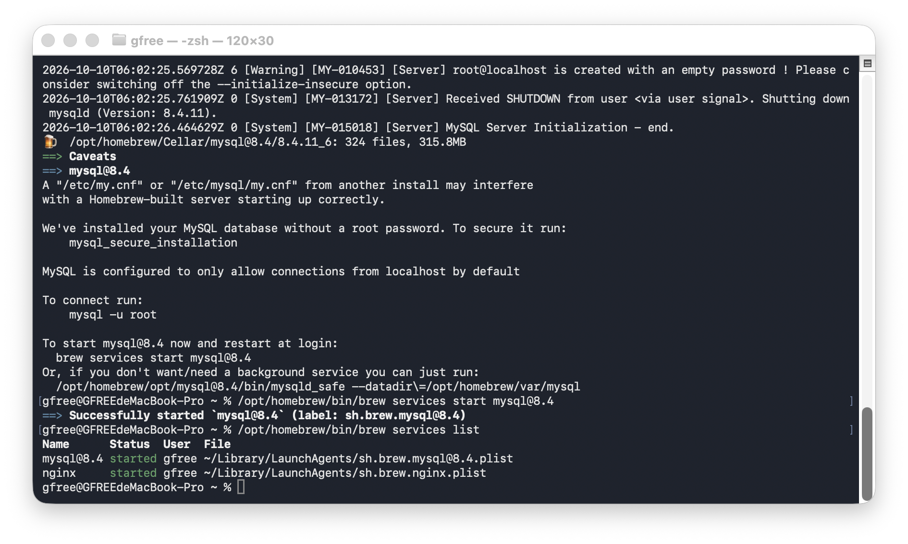
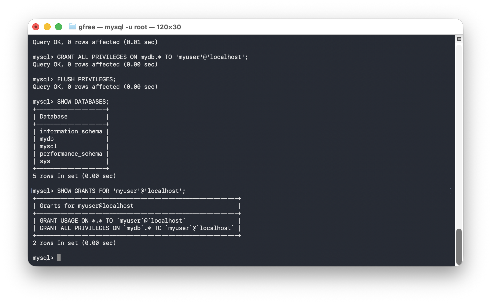

# 第四次 Linux 课程作业：搭建 MySQL 数据库服务器

- 姓名：郭雨杨
- 学号：B24040003
- GitHub 用户名：jenmax-116
- 实验日期：2026 年 10 月 10 日
- 实验环境：macOS（Apple Silicon），Homebrew，MySQL 8.4.11

## 实验目标与环境说明

安装并启动 MySQL，创建 `mydb` 数据库和 `myuser` 用户，授予数据库权限并检查结果。

经老师允许，本课程使用 macOS 完成实验。课件中的 `apt` 安装和 `systemctl` 状态查看改用 Homebrew 安装与服务管理。

## 安装、启动与状态检查

```bash
/opt/homebrew/bin/brew install mysql@8.4
/opt/homebrew/bin/brew services start mysql@8.4
/opt/homebrew/bin/brew services list
```

安装完成后，`mysql@8.4` 的服务状态显示为 `started`。



## 创建数据库和用户

进入 MySQL：

```bash
/opt/homebrew/opt/mysql@8.4/bin/mysql -u root
```

按照课件执行以下 SQL。密码为课件指定的本机练习密码。

```sql
CREATE DATABASE mydb CHARACTER SET utf8mb4 COLLATE utf8mb4_unicode_ci;
CREATE USER 'myuser'@'localhost' IDENTIFIED BY '111111';
GRANT ALL PRIVILEGES ON mydb.* TO 'myuser'@'localhost';
FLUSH PRIVILEGES;
SHOW DATABASES;
SHOW GRANTS FOR 'myuser'@'localhost';
```

`SHOW DATABASES` 的结果包含 `mydb`；用户权限结果包含对 `mydb.*` 的 `ALL PRIVILEGES`。截图中的授权和刷新权限操作均返回 `Query OK`。



## 图形客户端连接

本人已确认使用 DBeaver 连接成功。连接参数如下：

| 参数 | 值 |
| --- | --- |
| 数据库类型 | MySQL |
| 主机 | localhost |
| 端口 | 3306 |
| 数据库 | mydb |
| 用户名 | myuser |

本报告附件包含服务状态和 SQL 结果截图，尚未附上 DBeaver 连接截图。

## 实验结果

已完成 MySQL 服务安装与启动、数据库和用户创建、权限授予及结果检查，并完成本机图形客户端连接。未配置其他电脑远程访问数据库。
