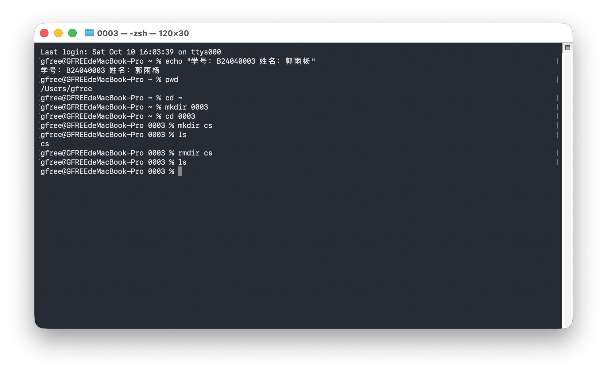
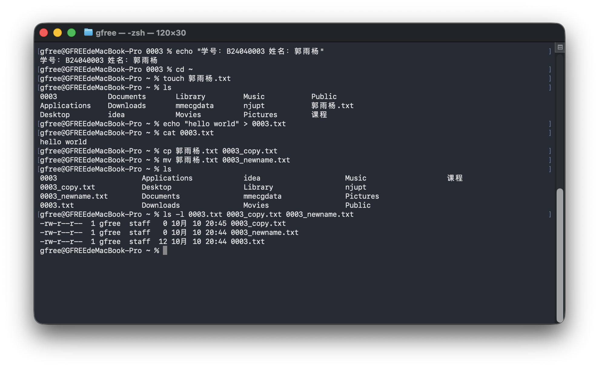
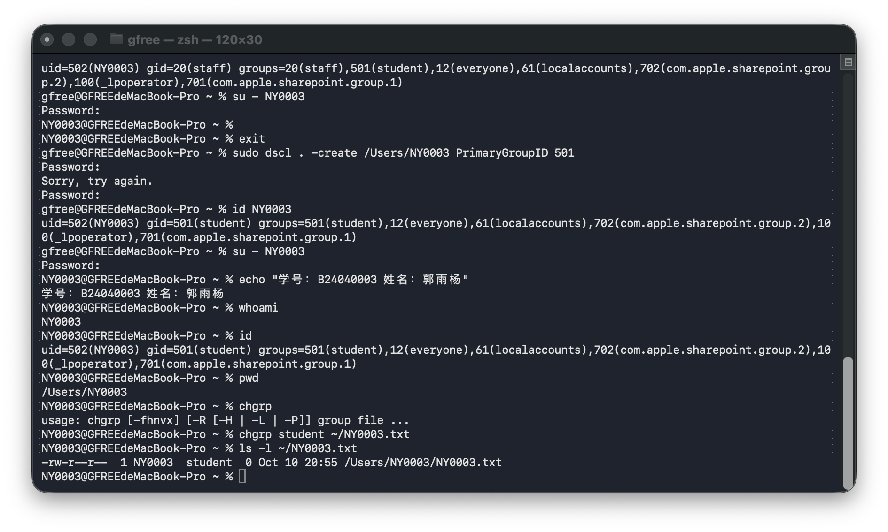
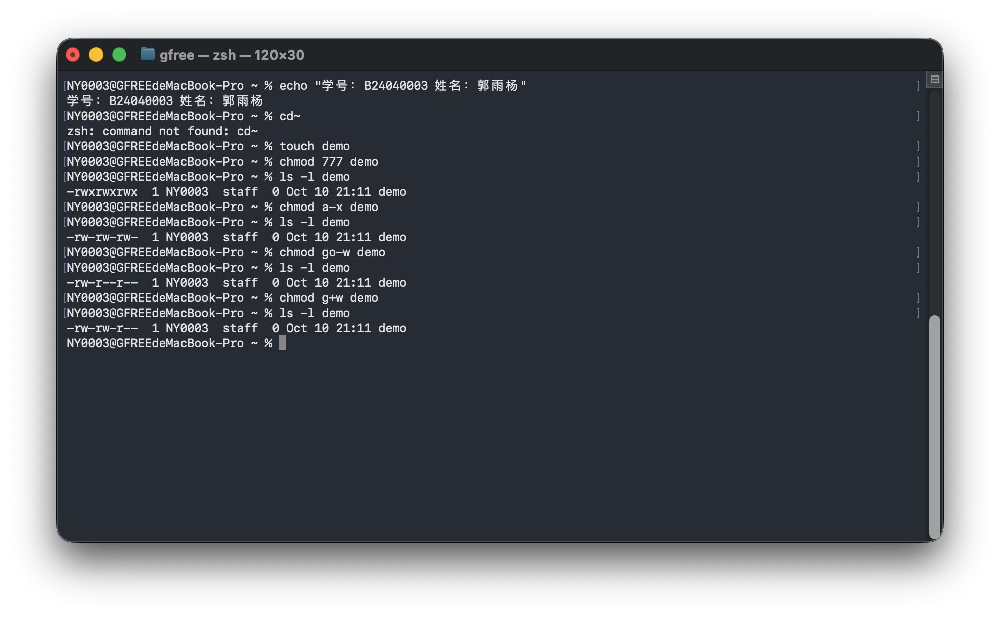
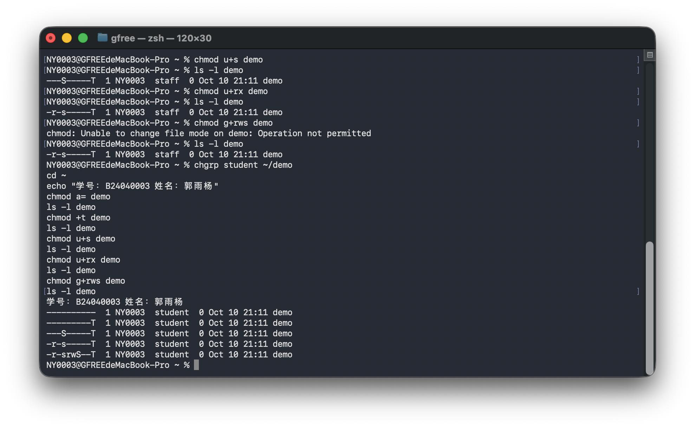
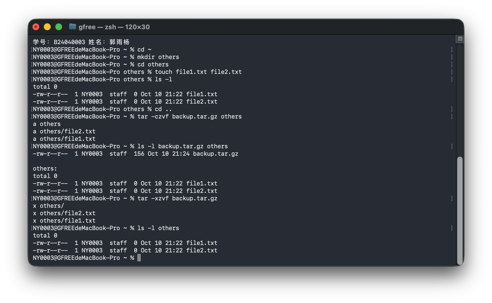
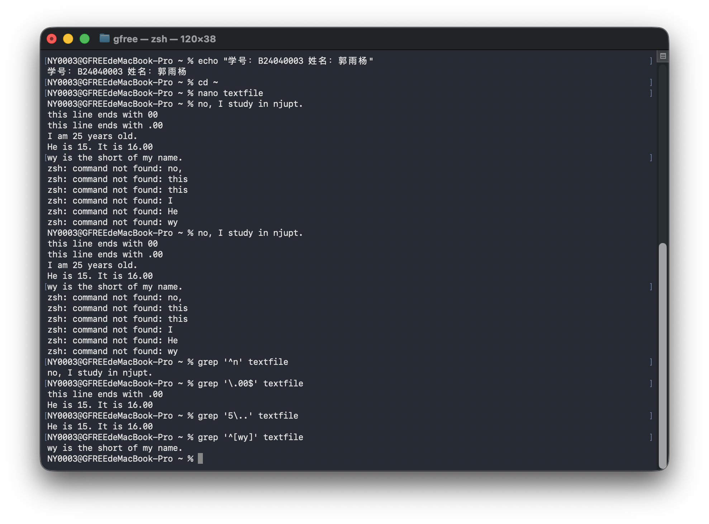

# 实验一：基本命令操作与服务器搭建

姓名：郭雨杨　学号：B24040003　GitHub：jenmax-116

基本命令实验日期：2026 年 10 月 10 日。

环境：macOS（Apple Silicon）、zsh、Homebrew、VS Code。

经老师允许，本课程在 macOS 环境中完成。通用文件命令直接在终端执行；用户与组管理采用 macOS 对应工具，服务器安装和服务管理采用 Homebrew。报告记录实际操作及结果，不将 macOS 操作描述为 Linux 原生命令。

## 一、目录操作

目标：查看工作目录，创建以学号末四位 0003 命名的目录，并创建、删除其子目录 cs。

```bash
pwd
cd ~
mkdir 0003
cd 0003
mkdir cs
ls
rmdir cs
ls
```

结果：初始目录为 /Users/gfree。创建 cs 后 ls 显示 cs；rmdir 后再次 ls 无输出，说明空目录删除成功。



---

## 二、文件操作

目标：创建文件、写入文本、复制和重命名。

```bash
cd ~
touch 郭雨杨.txt
ls
echo "hello world" > 0003.txt
cat 0003.txt
cp 郭雨杨.txt 0003_copy.txt
mv 郭雨杨.txt 0003_newname.txt
ls
ls -l 0003.txt 0003_copy.txt 0003_newname.txt
```

结果：cat 显示 hello world；0003.txt 大小为 12 字节，包括末尾换行。姓名文件初始为空，因此复制和重命名后的文件均为 0 字节；重命名后原姓名文件不再出现。



---

## 三、用户和组管理

在系统设置中创建普通用户 NY0003。使用以下 macOS 命令创建 student 组，并将实验用户的主组设为 student（本机组编号为 501）。

```bash
sudo dseditgroup -o create student
sudo dseditgroup -o edit -a NY0003 -t user student
sudo dscl . -create /Users/NY0003 PrimaryGroupID 501
su - NY0003
whoami
id
pwd
touch NY0003.txt
chgrp student ~/NY0003.txt
ls -l ~/NY0003.txt
```

结果：用户为 NY0003，uid=502，gid=501(student)，主目录为 /Users/NY0003；实验文件的所有者为 NY0003、所属组为 student。已有文件不会因用户主组修改而自动改变所属组，因此使用 chgrp 修正。



---

## 四、权限管理：普通权限

创建 demo 并逐次修改权限；每次使用 ls -l demo 验证。

```bash
touch demo
chmod 777 demo
ls -l demo
chmod a-x demo
ls -l demo
chmod go-w demo
ls -l demo
chmod g+w demo
ls -l demo
```

权限依次为 -rwxrwxrwx、-rw-rw-rw-、-rw-r--r--、-rw-rw-r--。r、w、x 分别表示读、写、执行；u、g、o 对应所有者、所属组和其他用户。



---

## 四、权限管理：特殊权限

最初 demo 属于 staff，设置组特殊权限时报 Operation not permitted。将文件组改为当前用户所属的 student 后，重新执行成功。

```bash
chgrp student ~/demo
chmod a= demo
ls -l demo
chmod +t demo
ls -l demo
chmod u+s demo
ls -l demo
chmod u+rx demo
ls -l demo
chmod g+rws demo
ls -l demo
```

结果依次为 ----------、---------T、---S-----T、-r-s-----T、-r-srwS--T。s/S 表示对应的 setuid 或 setgid 位，小写表示该位置同时具有执行权限；t/T 对应 sticky 位。这里验证的是权限位显示，demo 为空的普通文件，未验证程序运行时行为。



---

## 五、其他操作：压缩与解压

在 NY0003 主目录下创建 others 和两个空文件；回到 others 上一级后打包，避免归档路径错误。

```bash
cd ~
mkdir others
cd others
touch file1.txt file2.txt
ls -l
cd ..
tar -czvf backup.tar.gz others
ls -l backup.tar.gz others
tar -xzvf backup.tar.gz
ls -l others
```

结果：生成 156 字节的 backup.tar.gz。归档和解压输出均列出 others 及两个文件；解压后仍能看到 file1.txt 和 file2.txt。此次解压到已有目录，未删除原文件。



---

## 五、其他操作：文本查找

使用 nano 创建 textfile，内容如下：

```text
no, I study in njupt.
this line ends with 00
this line ends with .00
I am 25 years old.
He is 15. It is 16.00
wy is the short of my name.
```

```bash
grep '^n' textfile
grep '\.00$' textfile
grep '5\..' textfile
grep '^[wy]' textfile
```

结果：第一条匹配 no 开头的行；第二条匹配第 3、5 行；第三条匹配第 5 行中的“5. ”；第四条匹配第 6 行。^[wy] 表示以 w 或 y 中任意一个字符开头，不是必须以连续的 wy 开头。

截图中曾将六行文本粘贴到 shell，出现 command not found；后续四次 grep 均从已保存的 textfile 得到正确结果。



---

## 六、服务器搭建：OpenSSH

沿用 2026 年 9 月 9 日课堂操作记录。在 Mac 本机使用 SSH 客户端连接 localhost，验证 SSH 服务能够接受登录。

```bash
hostname
ssh $(whoami)@localhost
who
echo $SSH_CONNECTION
```

主机名为 GFREEdeMacBook-Pro.local；登录成功后，who 显示来自 ::1 的会话，SSH_CONNECTION 为“::1 52248 ::1 22”。其中服务端端口为 22，::1 为 IPv6 回环地址。本次为本机连接验证，不证明其他电脑可远程访问。


---

## 七、服务器搭建：Nginx

2026 年 10 月 10 日安装 Nginx 1.31.6，通过 Homebrew 启动服务。网页目录为 /opt/homebrew/var/www，访问地址为 http://localhost:8080。

```bash
/opt/homebrew/bin/brew install nginx
/opt/homebrew/bin/brew services start nginx
/opt/homebrew/bin/brew services list
```

先访问到 Welcome to nginx! 默认页面，再将 index.html 改为以下内容并保存，刷新后显示 hello, njupt。

```html
<html><body>hello, njupt</body></html>
```


---

## 八、服务器搭建：MySQL

2026 年 10 月 10 日安装 MySQL 8.4.11 并启动。服务列表显示 mysql@8.4 和 nginx 均为 started。

```bash
/opt/homebrew/bin/brew install mysql@8.4
/opt/homebrew/bin/brew services start mysql@8.4
/opt/homebrew/bin/brew services list
/opt/homebrew/opt/mysql@8.4/bin/mysql -u root
```


---

## 八、服务器搭建：MySQL 数据库与权限

按照课件创建数据库和本机练习用户：

```sql
CREATE DATABASE mydb CHARACTER SET utf8mb4 COLLATE utf8mb4_unicode_ci;
CREATE USER 'myuser'@'localhost' IDENTIFIED BY '111111';
GRANT ALL PRIVILEGES ON mydb.* TO 'myuser'@'localhost';
FLUSH PRIVILEGES;
SHOW DATABASES;
SHOW GRANTS FOR 'myuser'@'localhost';
```

结果：数据库列表包含 mydb，权限列表包含对 mydb.* 的 ALL PRIVILEGES。本人已确认 DBeaver 本机连接成功，但本报告没有对应连接截图。服务安装、数据库创建与授权均有截图验证。


## 九、实验总结

本次完成目录、文件、用户组、权限、归档和文本查找操作，并汇总三个服务器的搭建结果。操作中遇到命令空格遗漏、主组设置步骤遗漏、文件所属组不匹配和文本误粘贴到命令行等问题，最终通过身份、组和结果检查完成修正。macOS 的用户管理及服务管理方式与课件 Linux 命令不同，报告已分别说明。
